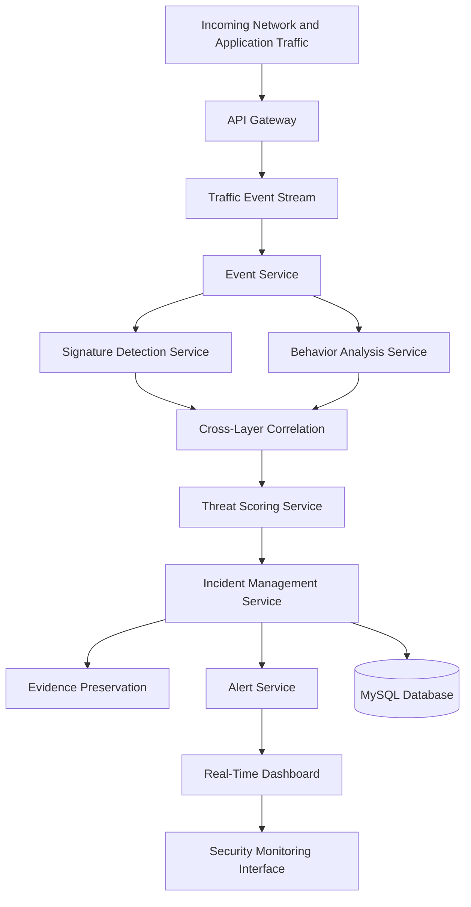

# 🛡️ Sentinel-IDS
### Intelligent Event-Driven Intrusion Detection and Security Monitoring System

**Sentinel-IDS** is an intelligent, event-driven Intrusion Detection System (IDS) designed to monitor network and application activities, detect potential cyber threats, correlate security events across multiple detection layers, and provide centralized security monitoring through a distributed microservices architecture.

The system combines signature-based detection, behavioral analysis, cross-layer threat correlation, adaptive threat scoring, and evidence preservation to identify suspicious activities and support security incident investigation.

---

## 🚀 Project Overview

Traditional intrusion detection systems often analyze security events independently, making it difficult to identify coordinated attacks that generate multiple related signals across different system layers.

Sentinel-IDS addresses this challenge through an event-driven architecture in which multiple specialized security services independently analyze incoming events and communicate their findings through a centralized event-processing pipeline.

The system aims to provide:

- Multi-layer security threat detection.
- Real-time security event processing.
- Cross-layer correlation of suspicious activities.
- Adaptive threat assessment and scoring.
- Centralized incident management.
- Evidence preservation for security investigation.
- Real-time security monitoring through a dashboard.

---

## 🏗️ System Architecture

Sentinel-IDS follows a distributed microservices architecture with independent services responsible for specific security operations.

### High-Level Architecture



### Core Microservices

| Service | Responsibility |
|---|---|
| API Gateway | Receives and manages incoming application traffic. |
| Event Service | Processes and distributes security-related events. |
| Signature Detection | Identifies known attack patterns and malicious input signatures. |
| Behavior Analysis | Examines suspicious activity and abnormal behavior. |
| Cross-Layer Correlation | Correlates related events generated across different detection layers. |
| Threat Scoring | Calculates threat scores and determines severity levels. |
| Incident Management | Creates, tracks, and manages security incidents. |
| Evidence Preservation | Maintains relevant security evidence for investigation. |
| Alert Service | Processes security alerts and notifications. |
| Dashboard | Provides centralized security monitoring and visualization. |

---

## 🔍 Key Features

### 1. Multi-Layer Threat Detection

The system uses multiple detection mechanisms to identify different categories of cyber threats.

Supported detection categories include:

- SQL Injection
- Cross-Site Scripting (XSS)
- Path Traversal
- Command Injection
- Suspicious application behavior

### 2. Cross-Layer Event Correlation

One of the central technical components of Sentinel-IDS is its cross-layer event correlation mechanism.

Instead of evaluating every security event independently, the system correlates related events generated by different detection services.

This helps identify suspicious activity patterns that may not be sufficiently represented by an individual detection result.

### 3. Adaptive Threat Scoring

Sentinel-IDS incorporates a threat assessment mechanism that evaluates detected security activities and assigns threat scores.

The assessment supports:

- Threat severity classification.
- Correlation-based threat assessment.
- Prioritization of security incidents.
- Identification of potentially critical activities.

### 4. Evidence Preservation

The system includes an evidence-preservation component designed to retain relevant information associated with detected security incidents.

This supports:

- Security investigation.
- Incident analysis.
- Threat activity tracking.
- Historical security review.

### 5. Event-Driven Processing

Redis-based event processing enables communication between independent microservices.

The architecture uses Redis Streams and consumer groups to distribute security events across processing services.

### 6. Real-Time Security Monitoring

The centralized dashboard provides visibility into security incidents and system activity.

The monitoring architecture uses Socket.IO for real-time event communication.

### 7. Centralized Incident Management

Security findings are processed into incidents and stored using MySQL, enabling centralized incident tracking and investigation.

---

## 🧰 Technology Stack

| Category | Technologies |
|---|---|
| Backend | Node.js, Express.js |
| Frontend | Next.js, React.js |
| Programming Language | JavaScript |
| Event Processing | Redis, Redis Streams |
| Database | MySQL |
| Real-Time Communication | Socket.IO |
| Architecture | Distributed Microservices |
| Containerization | Docker |
| API Testing | Postman |
| Version Control | Git, GitHub |

---

## 📂 Project Structure

```text
sentinel-ids/
│
├── gateway/
│   └── API Gateway
│
├── server/
│   └── Core Backend Services
│
├── event-service/
│   └── Event Processing
│
├── signature-service/
│   └── Signature-Based Detection
│
├── behavior-service/
│   └── Behavioral Analysis
│
├── cross-layer-correlation-service/
│   └── Event Correlation
│
├── threat-service/
│   └── Threat Assessment and Scoring
│
├── incident-service/
│   └── Incident Management
│
├── evidence-preservation-service/
│   └── Evidence Management
│
├── alert-service/
│   └── Alert Processing
│
├── dashboard/
│   └── Next.js Monitoring Dashboard
│
└── README.md
```

*Note: Adjust the directory names above to match the actual repository structure.*

---

## ⚙️ Installation and Setup

### Prerequisites

Install the following before running the project:

- Node.js
- npm
- MySQL
- Redis
- Docker (optional, for containerized services)
- Git

### 1. Clone the Repository

```bash
git clone https://github.com/YOUR_USERNAME/sentinel-ids.git

cd sentinel-ids
```

### 2. Install Dependencies

Install dependencies separately inside each microservice directory.

```bash
cd gateway
npm install
```

Repeat the installation process for the other services and dashboard.

### 3. Configure Environment Variables

Create the required `.env` files for individual services.

Example configuration:

```env
PORT=4000

MYSQL_HOST=localhost
MYSQL_PORT=3306
MYSQL_USER=root
MYSQL_PASSWORD=your_password
MYSQL_DATABASE=sentinel_ids

REDIS_HOST=localhost
REDIS_PORT=6379

NODE_ENV=development
```

Configure additional environment variables according to each service's requirements.

**Security:** Never commit actual credentials, database passwords, API keys, or production secrets to GitHub.

### 4. Start Redis

If using Docker:

```bash
docker run -d \
  --name sentinel-redis \
  -p 6379:6379 \
  redis:7
```

### 5. Start MySQL

Ensure that your MySQL server is running and the required database and tables have been configured.

### 6. Start Microservices

Run each service using its configured npm development script.

```bash
npm run dev
```

### 7. Start the Dashboard

```bash
cd dashboard
npm install
npm run dev
```

Open the local dashboard URL displayed in the terminal.

---

## 🧪 Security Testing

Sentinel-IDS can be evaluated using controlled security testing scenarios.

| Attack Category | Example Test |
|---|---|
| SQL Injection | `' OR 1=1 --` |
| Cross-Site Scripting | `<script>alert(1)</script>` |
| Path Traversal | `../../etc/passwd` |
| Command Injection | Controlled command-injection payloads |

The detection pipeline processes incoming traffic, evaluates suspicious patterns, and generates security findings for further assessment.

**Testing should only be performed against systems you own or have explicit authorization to assess.**

---

## 🎯 Research and Technical Innovation

Sentinel-IDS explores the following technical areas:

1. Distributed microservices-based intrusion detection.
2. Event-driven security monitoring.
3. Multi-layer threat detection and analysis.
4. Cross-layer correlation of security events.
5. Adaptive threat assessment.
6. Evidence preservation for security incident investigation.
7. Centralized real-time security monitoring.

The research focus is on improving the identification and assessment of related security activities through coordinated analysis across independent detection layers.

---

## 🔮 Future Enhancements

Potential future development directions include:

- Machine-learning-based anomaly detection.
- Advanced behavioral profiling.
- Threat intelligence integration.
- Automated incident response.
- Improved false-positive reduction.
- Advanced security analytics.
- Distributed deployment and scalability improvements.
- Enhanced forensic evidence analysis.

---

## 📸 Screenshots

Add screenshots of your actual dashboard and system execution here.

```text
docs/
├── architecture.png
├── dashboard.png
├── incidents.png
└── threat-monitoring.png
```

---

## 🎓 Project Information

**Project:** Sentinel-IDS  
**Category:** Cybersecurity / Intrusion Detection System  
**Architecture:** Event-Driven Microservices  
**Domain:** Network Security and Threat Detection  
**Purpose:** Security Research and Development

---

## 🤝 Contributing

Contributions, suggestions, and technical improvements are welcome.

1. Fork the repository.
2. Create a feature branch.
3. Implement your changes.
4. Submit a pull request.

---

## ⚠️ Disclaimer

Sentinel-IDS is developed for educational, research, and authorized security-testing purposes.

The system is a security monitoring and threat detection research project and should not be considered a replacement for a professionally validated enterprise security solution.

---

## 📜 License

Specify the applicable open-source license before distributing this project.

---

**Built with a focus on distributed security monitoring, intelligent threat detection, and cross-layer security analysis.**
